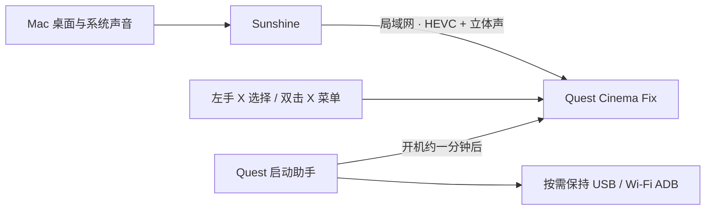

# quest1-desktop-kit

把闲置的 **Oculus / Meta Quest 1** 用作电脑的 VR 大屏：Sunshine 串流、原生影院、单左手柄操作、立体声、开机自启与 ADB 保持工具。

这是一次真实设备改造的可复用整理。已在一台 **Quest 1 v50 / Android 10、仅有左 Touch 手柄、Apple Silicon Mac** 上验证。电脑继续用自己的键盘鼠标；头显负责显示和播放声音。

**[开始安装](docs/SETUP.md) · [没有手柄](docs/CONTROLLER-FREE.md) · [本地视频](docs/LOCAL-VIDEO.md) · [Mac 控制台](docs/CONSOLE.md) · [音量键打开应用列表](docs/VOLUME-SHORTCUT.md) · [构建 APK](docs/BUILD.md) · [故障排查](docs/TROUBLESHOOTING.md) · [恢复原设置](docs/RECOVERY.md) · [English](README.en.md)**



## 可以实现什么

| 功能 | 本次结果 |
| --- | --- |
| 桌面大屏 | 原生 VR 影院，可在 Void 场景调节屏幕距离 |
| 只有左手柄 | 注视目标 + X 选择；快速双击 X 返回或切换影院菜单 |
| 系统声音 | 2 声道；左右独立测试音通过 |
| 本地视频（影院 v12） | 影院里多了 Local Videos，直接播放头显 Movies / Download 里的视频；海报显示完整文件名，支持断点续播和手柄暂停、快进 |
| 完全没有手柄 | 影院里用音量键选择和返回；主页按住“减加减加”打开应用列表；主页空着时自动打开应用列表 |
| Mac 控制台 | 本机网页：状态、截图、打开或安装应用、传视频、系统设置页、电源、助手开关、Sunshine |
| 视频恢复（影院 v8） | 多纠错块整帧重组、损坏帧丢弃与显式关键帧请求；约 3 分钟实机测试画面和声音稳定 |
| 开机打开影院 | 启动助手等待系统就绪、头显唤醒后，每次开机只打开一次 |
| 快速入口 | Lightning Launcher 中带 ★ 的影院入口排在前面 |
| 没有右手柄时重新打开应用 | 头显音量键快速按“减、加、减、加”，直接打开应用列表；已用实体按键确认 |
| 长期 ADB | 可分别开启 USB / Wi-Fi 保持；USB 已做真实重启验证 |
| Featured | 可选择停用商店包，避免其开机面板；可以恢复 |
| 时间 | 自动校时 + 手动指定正确的 IANA 时区 |

这是 **桌面镜像**。仓库没有实现独立的 macOS 扩展显示器、刷第三方系统、root 或解锁 bootloader。普通 Moonlight 的 2D 窗口在本设备上过小，因此选择了旧版原生 VR 影院并修复兼容问题。

## 先确认前提

1. 你自己的 Quest 1 已联网，而且电脑至少能通过一种方式运行 `adb shell`。
2. 电脑和头显在同一可信局域网；电脑装有 Sunshine，并允许读取屏幕和系统音频。
3. 左手柄可正常选择目标。影院主要用注视来定位，不能照搬现代 Quest 应用的控制说明。

**本仓库不提供“全新恢复出厂设备一键跳过右手柄配对”。** 实机曾卡在初始配对，使用 Android 手机辅助取得了 ADB 访问，但这一部分没有形成足以公开复现的完整引导流程。尚无 ADB 的读者先看[初始化边界与已知现象](docs/BOOTSTRAP.md)，不要为了安装此工具而重置已能使用的设备。

## 最短安装路径

以下命令在仓库根目录运行，需要 Python 3.10+ 与 Android platform-tools。影院 v8 还需要 **NDK r27c**，面向 **Quest 1 v50 / arm64-v8a / Android API 29**，公开 APK 的最低 API 为 29；APK 打包需要 JDK 和 Android SDK。详见[构建说明](docs/BUILD.md)。

```sh
git clone https://github.com/Integ/quest1-desktop-kit.git
cd quest1-desktop-kit
python3 tools/quest.py info

# 从固定上游源码构建 v8 网络模块，再应用影院补丁和本地签名
python3 tools/build_native.py --ndk /path/to/ndk
python3 tools/build_cinema.py --native-library dist/libmoonlight-core.so
python3 tools/build_helper.py

python3 tools/quest.py install-cinema dist/QuestCinemaFix-v8.apk
python3 tools/quest.py install-helper dist/QuestStartupHelper-v10.0.apk

# 可选：影院 v12（本地视频），以上面的 v8 为输入
python3 tools/build_cinema_v12.py
python3 tools/quest.py install-cinema dist/QuestCinemaFix-v12.apk
```

启动助手也可以从 [Releases](https://github.com/Integ/quest1-desktop-kit/releases) 下载，先验证附带的 SHA-256。影院涉及上游 SDK 和素材，提供源码补丁与本地构建工具，**不在本仓库或 Release 上传完整影院 APK、SDK 素材或预编译网络库**。v8 校验固定源码和打包输入，确认原有 Java / VR 代码保持基线，再加入你构建的网络模块；不同工具链或构建路径的原生库不承诺字节级一致。

按需开启功能，安装本身不会默认启用：

```sh
python3 tools/quest.py keep-usb on
python3 tools/quest.py keep-wifi on
python3 tools/quest.py autostart on
python3 tools/quest.py volume-shortcut on
python3 tools/quest.py idle-launcher on      # 主页空着时自动打开应用列表（v10）
python3 tools/quest.py open-cinema
```

`autostart on` 对**下一次开机**生效；当前立即打开用 `open-cinema`。保持工具需要一次 ADB 授予 `WRITE_SECURE_SETTINGS`，安装脚本会执行。自启或音量快捷入口还会授予 `SYSTEM_ALERT_WINDOW` 特殊访问权限，以符合 Android 10 后台启动规则；助手不绘制悬浮窗。详见[权限与行为](docs/ADB-AND-STARTUP.md)。

影院退出后：保持头显戴着，快速按实体音量键 **减 → 加 → 减 → 加**，再用左手柄点应用列表前排的 **★ Quest Cinema Fix**。每次间隔不超过 1.5 秒；完全静音时先提高一格音量。这个入口由头显上的助手提供，使用时无需电脑连接。详见[快捷入口说明](docs/VOLUME-SHORTCUT.md)。

已装的同包名 APK 必须使用相同签名才能覆盖更新。第一次自建会在 `.local/signing/` 生成自己的签名；备份它，别上传它。遇到签名不一致时先看构建说明，不要直接卸载丢掉已有配对数据。

## 连接电脑和操作

1. 安装并运行 [Sunshine](https://github.com/LizardByte/Sunshine)，允许系统的屏幕／系统音频捕获权限。在本机管理界面配置一个 `Mac Desktop` 条目。
2. 影院选择电脑；没有自动发现时手动填电脑的局域网地址。配对码在头显出现后，在 Sunshine 本机管理界面的 PIN 页面提交。
3. 选择 `Mac Desktop`。该版本固定优先 **H.265 / HEVC**，保持硬件编码；不要沿用排障中尝试过的软件编码配置。
4. 画面太小时：选 **Void** 场景，快速双击左手 **X** 打开菜单，选显示设置，减小 **Distance**。Home Theater 的固定银幕不适合这个调节方式。

| 左手操作 | 用途 |
| --- | --- |
| 看向目标，单击 X | 选择电脑、桌面或菜单项 |
| 快速连续按两次 X | 返回设置页、开关影院菜单 |
| 保持按住并拖动 | 保留原有拖动行为；拖动不会当作双击 |
| Y / 三横线菜单键 | 旧兼容层实机没有可靠传入，不作为必要操作 |

Sunshine 通用配置生成和完整配对步骤见[安装说明](docs/SETUP.md)。脚本默认关闭远端键盘、鼠标、手柄转发与 UPnP，保留桌面和声音串流。本次 v8 实测使用 `max_bitrate = 8000`（Kbps）为无线链路留出余量，HEVC 硬件编码和正常纠错保持开启；限码率不是对旧崩溃代码的替代修复。

## 仓库内容

| 路径 | 内容 |
| --- | --- |
| `helper/` | Quest 启动助手 v10 完整 Java 源码、Manifest 和资源 |
| `cinema/v12/` | 影院 v12 的 Java 源码（音量键导航、本地视频）和编译用的存根 |
| `console/` | Mac 控制台（Python 标准库 + 静态网页） |
| `cinema/java/`、`cinema/smali/` | 左手输入逻辑的 Java 源码及实际补丁使用的 smali |
| `cinema/patches/` | Android 10、HEVC、立体声、输入兼容与星标入口补丁 |
| `cinema/patch-manifest.json` | 原版哈希、精确补丁、原生库字节修复与结果哈希 |
| `cinema/native/` | v8 的 10 个已测试 C / 头文件、固定基础提交与源码校验信息 |
| `tools/` | 构建、设备选择、ADB / 自启管理、Sunshine 配置和会话恢复 |
| `tests/` | 20 项 Python 测试、3 组 Java 输入/手势测试，以及音视频 RTP/FEC 回归 |
| `docs/` | 安装、初始化边界、技术修复、实机验证和撤销方法 |

运行不接触设备的回归检查：

```sh
python3 tools/test.py
```

## 验证范围和授权

公开 v8 流程已完成网络模块构建、两阶段 APK 打包、代码哈希及 API/版本/签名验证；20 项 Python、3 组 Java 和 ASan/UBSan 回归全部通过。版本、重启结果和用户确认记录见[验证记录](docs/VALIDATION.md)。目前是一台设备的结果；主机端新整理的管理脚本做了模拟设备选择测试，没有把它们重新应用到已配置好的头显。Windows / Linux 主机和其他固件尚未做端到端验证。

**v8 验证范围：** v7 后续出现的视频纠错断言和恢复问题已在 v8 中针对处理。用户确认约 3 分钟画面稳定、声音正常，日志观察到真实丢帧后的恢复且无新致命错误。Mac VideoToolbox 仍可能输出关键帧警告；尚未做长时间、所有网络环境或新的重启测试，保留预发布标记。助手仍为 v4。

发布内容已去除个人序列号、内网地址、网络名称、配对信息、ADB 私钥、主机密码、原始日志和签名私钥。每个使用者都需要自己的配对和签名。

本项目原创代码使用 **GPL-3.0-or-later**；第三方文件和补丁上下文保留原授权。完整归属见 [NOTICE](NOTICE.md) 及 [LICENSES](LICENSES/)。这是社区整理，与 Meta、Moonlight、Sunshine 原作者没有隶属关系。
